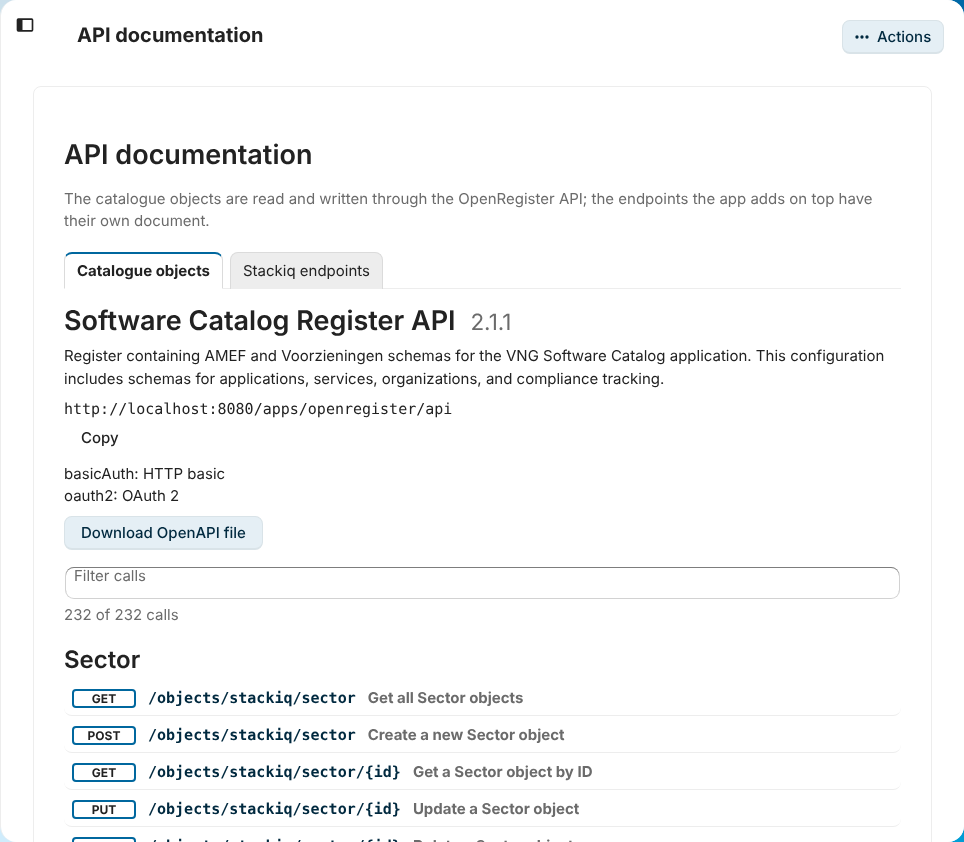

<!--
  - SPDX-FileCopyrightText: 2026 Conduction B.V. <info@conduction.nl>
  - SPDX-License-Identifier: EUPL-1.2
  -->

# API documentation

Read the two documents that describe the catalogue's API, inside stackiq.

Specification: [`openspec/changes/sharing-generated-api-docs/specs/generated-api-docs/spec.md`](https://github.com/ConductionNL/stackiq/blob/development/openspec/changes/sharing-generated-api-docs/specs/generated-api-docs/spec.md).

## Where

**API documentation** in the footer of the navigation, beside Documentation. The page is at `/apps/stackiq/api-docs`.

## Two documents

The catalogue is served by two APIs, and the page has a tab for each:

| Tab | What it describes | Where the document comes from |
|-----|-------------------|-------------------------------|
| Catalogue objects | Reading and writing applications, services, usages, connections, contracts and the other catalogue objects | OpenRegister's OpenAPI document of the `stackiq` register, `GET /apps/openregister/api/registers/{id}/oas` |
| Stackiq endpoints | The endpoints stackiq adds on top: offers, offered usage, views, reports, the CMDB import, settings | stackiq's own OpenAPI document, `GET /apps/stackiq/api/openapi.json` |

Each tab loads its document when you first open it, and shows:

- the title, version and servers of the API;
- the calls grouped by tag, each with its method, path, parameters, request body and responses;
- the models (schemas) with their properties;
- a filter to narrow the calls;
- **Download OpenAPI file**, which saves the document as JSON.

The documents are fetched from your own instance with your session and shown by stackiq itself. No outside viewer is loaded and the document address is not sent anywhere.

## When a tab says the document is not available

- **Catalogue objects** needs the catalogue register to be configured. Until it is, the tab says the document is not available on this instance.
- A document you may not read says so; a document that does not load says it could not be loaded.

## The hand-written endpoint descriptions

`GET /apps/stackiq/api/views/docs` and `GET /apps/stackiq/api/aangeboden-gebruik/docs` still answer with their hand-written description, for the integrations that read them. Both now carry a `documentation` entry with the page (`/apps/stackiq/api-docs`) and the OpenAPI document (`/apps/stackiq/api/openapi.json`). New integrations use the OpenAPI document.

## Screenshot

A screenshot of the page follows once it can be taken against a running instance.
