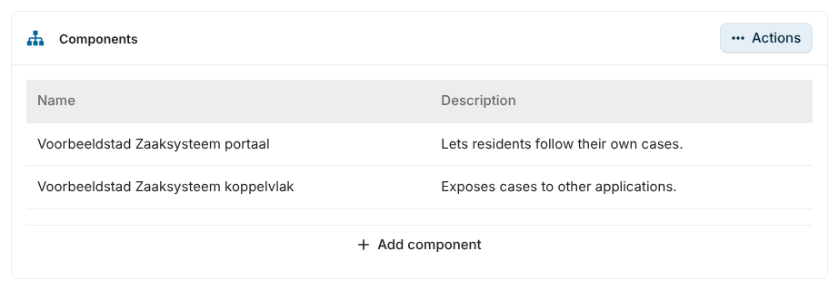

<!--
  - SPDX-FileCopyrightText: 2026 Conduction B.V. <info@conduction.nl>
  - SPDX-License-Identifier: EUPL-1.2
  -->

# Application components

An application can be made of other applications: a case system with its citizen portal and its API, for example. Each part is an application of its own, with its own versions, usages, connections and standards, and names the application it is a component of.

Specification: [`openspec/changes/archive/2026-11-25-landscape-application-components/specs/application-components/spec.md`](https://github.com/ConductionNL/stackiq/blob/development/openspec/changes/archive/2026-11-25-landscape-application-components/specs/application-components/spec.md).

## Recording a component

1. Open **Applications** and click the application, for example *Zaaksysteem*.
2. In **Components**, click **Add component**.
3. Fill in the name and description of the component, for example *Zaaksysteem portaal*, and save.

The new application names *Zaaksysteem* in **Part of**. You can also set **Part of** on an existing application from its own page: the choice offers only applications of the same supplier.

An application cannot be part of itself, and it cannot be part of one of its own components. Stackiq refuses such a save with "An application cannot be part of itself." or "An application cannot be part of one of its own components.", and the application keeps the parent it had.

## Reading what an application is made of

The application page lists its components under **Components**. Each row opens that component's page, which shows the application it is part of under **Part of**.

## The Applications list

The **Applications** list opens on **Whole applications**: applications that are not a component of another one. Pick **All, including components** to see the components too.

## Demo data

The demo data has *Voorbeeld Zaaksysteem* with two components, *Voorbeeld Zaakportaal* and *Voorbeeld Zaken-API*.
