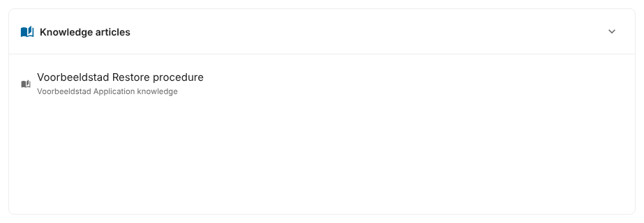
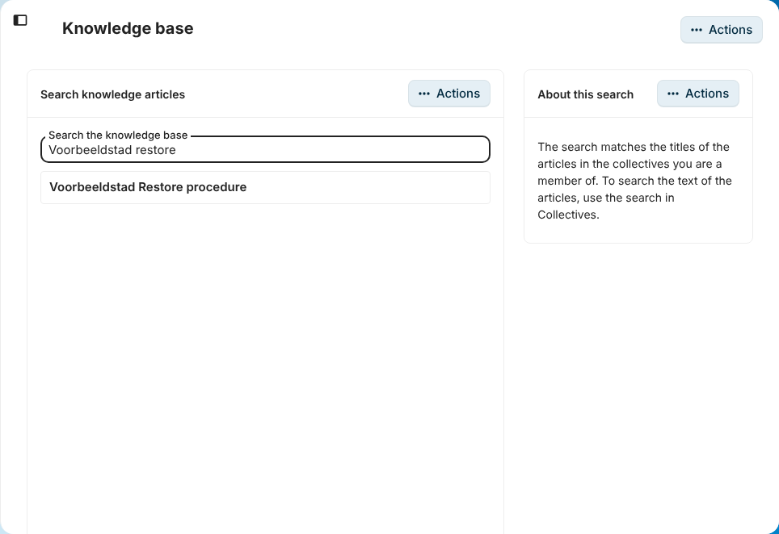

<!--
  - SPDX-FileCopyrightText: 2026 Conduction B.V. <info@conduction.nl>
  - SPDX-License-Identifier: EUPL-1.2
  -->

# Knowledge base

Knowledge articles about an application, such as how it is set up, how to recover it or what to tell new users, are kept in Nextcloud Collectives, the knowledge base Nextcloud already ships. Stackiq links those articles to the application, lists them on the application page and lets you search them from a Knowledge base page.

Stackiq keeps no copy of an article. The text, its history and its sharing are Collectives': who can read an article is decided by the membership of its collective, not by a stackiq role.

Specification: [`openspec/changes/archive/2026-11-28-insight-knowledge-base/specs/application-knowledge-base/spec.md`](https://github.com/ConductionNL/stackiq/blob/development/openspec/changes/archive/2026-11-28-insight-knowledge-base/specs/application-knowledge-base/spec.md).

## Before you start

An administrator installs the **Collectives** app from the Nextcloud app store and creates at least one collective, for example *Application knowledge*, with the people who write and read the articles as members.

Without Collectives the knowledge base is absent, not broken:

- the **Knowledge base** entry does not appear in the menu;
- the **Knowledge articles** panel on an application page says that Collectives is not installed;
- opening `/knowledge` directly says that the page needs Collectives.

## Articles on the application page

Open **Applications**, then an application. Below the other sections, the **Knowledge articles** panel lists the Collectives pages linked to this application, each with the collective it belongs to. Choosing one opens it in Collectives.

In the application's sidebar (open it with the button at the top right), the **Collectives** tab lets an application owner:

- **link** an existing Collectives page they can read;
- **create** a new page in one of their collectives, which is linked in the same step;
- **unlink** a page. The page stays in Collectives; only the link to the application goes.

The **Documentation** panel stays as it was: it holds attached files, such as a manual in PDF, which are documents rather than articles.

A reader who is not a member of the article's collective sees its title in the panel, and Collectives refuses when they open it.

## Searching the knowledge base

Open **Applications**, then **Knowledge base**. Type at least two characters in the search box: the results list the Collectives pages whose **title** matches, across the collectives you are a member of. Choosing a result opens the page in Collectives in a new tab.

The search matches titles only. To search the text of the articles, use the search in Collectives itself; the hint beside the search box links to it.

## For administrators

- The panel and the sidebar's **Collectives** tab are OpenRegister's `collectives` integration: the links are stored by OpenRegister, per application.
- The search page calls OpenRegister's Collectives page search (`/apps/openregister/api/integrations/collectives/available?search=`).
- All of it is configuration in the app manifest (`src/manifest.json`: widget `md-knowledge` and the application page's sidebar tab `collectives`; `src/manifest.d/insight-knowledge-base.json`); there is no stackiq schema, endpoint or setting for articles.
