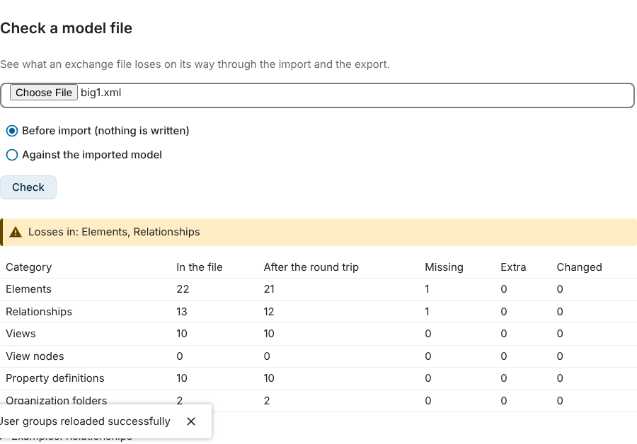

<!--
  - SPDX-FileCopyrightText: 2026 Conduction B.V. <info@conduction.nl>
  - SPDX-License-Identifier: EUPL-1.2
  -->

# ArchiMate import and export

Stackiq reads and writes ArchiMate exchange files (the Open Group exchange format, `.xml`). GEMMA models come in this way, and the catalogue goes out the same way to architecture tools such as BiZZdesign or Archi. The import, the export and the round-trip check are in the **ArchiMate** section of the app's admin settings (**Administration settings → Stackiq**). Only Nextcloud administrators can use them.

Specification: [`openspec/changes/architecture-round-trip-check/specs/archimate-round-trip-check/spec.md`](https://github.com/ConductionNL/stackiq/blob/development/openspec/changes/architecture-round-trip-check/specs/archimate-round-trip-check/spec.md).

## Check a model file

Before you import a model, or after you imported it, you can check what the file loses on its way through stackiq. The check writes nothing.

1. Under **Check a model file**, pick the exchange file.
2. Choose a mode:
   - **Before import (nothing is written)**: stackiq converts the file the way the import does, generates an exchange file from the result the way the export does, and compares the two.
   - **Against the imported model**: stackiq takes the stored objects whose model identifier is the file's, generates an exchange file from them, and compares that with the file. If nothing with that model identifier is stored, the answer is "This model is not imported."
3. Choose **Check**.

The result has one row per category: elements, relationships, views, view nodes, property definitions and organization folders. Each row gives:

| Column | Meaning |
|--------|---------|
| In the file | How many the uploaded file holds |
| After the round trip | How many the generated file holds |
| Missing | In the file, not after the round trip |
| Extra | After the round trip, not in the file |
| Changed | In both, with a field that differs |

Items are matched by their identifier, so their order in the file does not matter. Elements are compared on type, name, documentation and property values; relationships on type, source, target, name and property values; views on name, viewpoint and the nodes and connections they reference; view nodes on element reference, parent, position and size.

For every category with losses, **Examples** lists up to 50 of them, each with its identifier, its name and, for a changed one, the fields that differ. The counts are always complete. The summary at the top reads **No losses found**, or names the categories with losses.

The import and the full export use the same conversion and the same generation as the check, so a clean check means the import keeps everything the check compared.

### The API

`POST /index.php/apps/stackiq/api/archimate/round-trip-check` with a multipart upload in the field `archiMateFile` and `mode` set to `before-import` (the default) or `against-imported`. A user who is not an administrator gets 403 before anything is read. A `file_path` parameter, an unknown mode or a missing upload gets 400. The answer holds `mode`, `modelIdentifier` and `imported`, and, when imported, `lossless` and `categories` with the counts and examples per category.

