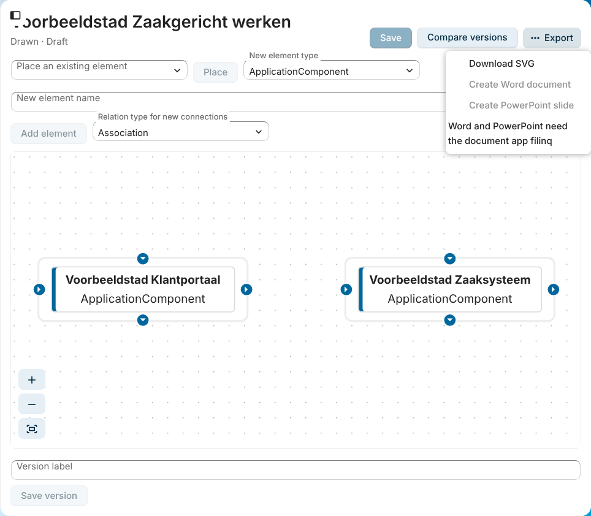
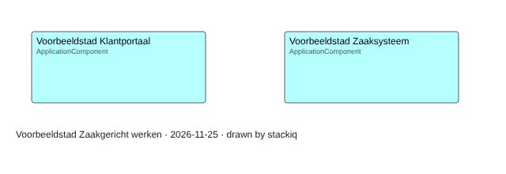

<!--
  - SPDX-FileCopyrightText: 2026 Conduction B.V. <info@conduction.nl>
  - SPDX-License-Identifier: EUPL-1.2
  -->

# Architecture views

Draw your own ArchiMate views in stackiq, tag them, give them a status, save named versions and compare two of them. The GEMMA views that come in with the GEMMA import stay as VNG published them: you copy one to make your own version.

Specification: [`openspec/changes/architecture-views-editor/specs/architecture-views-editor/spec.md`](https://github.com/ConductionNL/stackiq/blob/development/openspec/changes/architecture-views-editor/specs/architecture-views-editor/spec.md).

## Finding views

Open **Architecture** in the navigation menu, then **Views**. The list holds the imported GEMMA views and the views drawn in your organisation, with their viewpoint, status, tags and origin.

- The quick filters **All**, **Mine**, **Drawn** and **Imported** narrow the list to everything, the views you own, the drawn views or the GEMMA views.
- The sidebar filters on **tags**, **status** (draft, in review, published, retired) and **origin**.

## Drawing a view

Click **New view**, give it a name and click **Create view**. The editor opens with an empty canvas.

- **Place an existing element**: search an element of the GEMMA model or one drawn before, and click **Place**. The element is placed by reference and is not changed.
- **Add element**: choose an ArchiMate type, such as Application component, type a name and click **Add element**. The element is created when you save.
- **Connect**: choose the **Relation type for new connections**, then drag from one element to another, or use the keyboard on a focused element. Every connection refers to a relation between the two elements: an existing relation of that type is reused, otherwise a new one is created when you save.
- Move and resize elements on the canvas; remove one with Delete.

Click **Save**. A save that fails keeps your drawing; save again to retry, without creating relations twice.

Only one person edits a view at a time. While a colleague has a view open for editing, you see it read-only, with a notice naming who is editing it.

## GEMMA views

A view from the GEMMA import opens read-only, because the next import would overwrite any change. Click **Copy to edit** to make a drawn copy: it opens in the editor as a draft, with **Based on** naming the GEMMA view. A later import updates the GEMMA view and leaves the copy as it is.

## Versions

In the editor, type a **Version label** and click **Save version** to keep a numbered copy of the saved view. Click **Compare versions** to compare two versions, or a version with the current view: both are drawn side by side, with added items marked in green, removed items in red and changed items in yellow, and the same changes listed as text below.

## Exporting a view

On a saved view, the **Export** menu in the header has three actions:

- **Download SVG** downloads the view as an SVG image, named after the view. It is drawn from the view's stored positions and sizes, so it looks like the editor, and it always works.
- **Create Word document** and **Create PowerPoint slide** ask the document app filinq for a Word document or a PowerPoint slide holding the view: its name, description, viewpoint, a legend of the element types, the date, a link back to the view and the image. filinq files the result in your Files, and **Open in Files** opens it.

Without filinq on the instance, the two document actions are disabled and the menu says "Word and PowerPoint need the document app filinq". Download SVG still works.

## Views drafted by an assistant

An assistant in Hermiq can draft a view for you from a description, such as "draw how our case system talks to document management". It uses two stackiq tools:

- **stackiq.searchArchitectureElements** finds the GEMMA elements and the drawn elements that fit, so the draft reuses them instead of inventing new ones.
- **stackiq.draftView** writes the view in status draft. It reuses an element of the same type and exact name, and a relation of the same type between the same two elements. A draft holds at most 60 elements and 120 relations.

Both tools run with your own rights: an assistant cannot draft a view you could not create yourself, and it only finds elements you can see. Hermiq asks you to approve a draft before the tool runs.

A drafted view opens in the editor with the notice "Drafted by an assistant for *user* on *date*" and the origin **Drafted by an assistant**. Its elements are laid out automatically the first time it opens; click **Save** to keep that layout, move elements first if you like. The view, and every element and relation the assistant created, keep the origin `assistant` after you edit them, so the **origin** filter on the Views list finds them. Review the draft before you submit it.

## Who sees what

GEMMA views, elements and relations are public. Views, elements and relations drawn in stackiq are only read by signed-in users of the organisation that drew them, and they stay out of the shared views list (`/api/views`) and of the full ArchiMate export. Drafted views are treated the same way.
