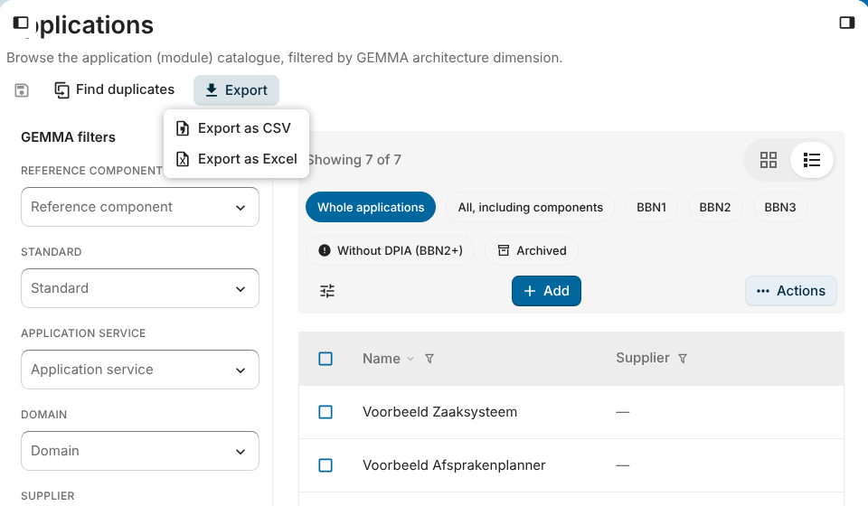
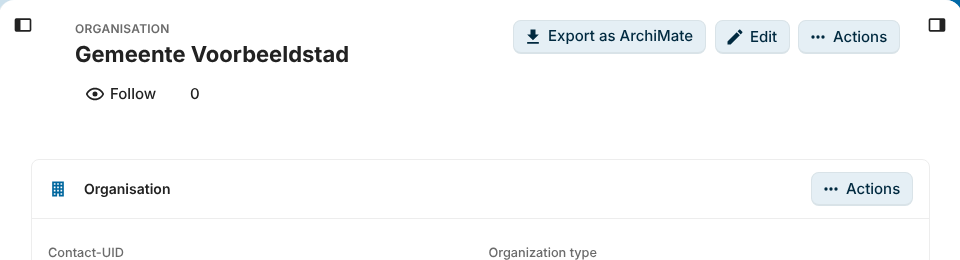
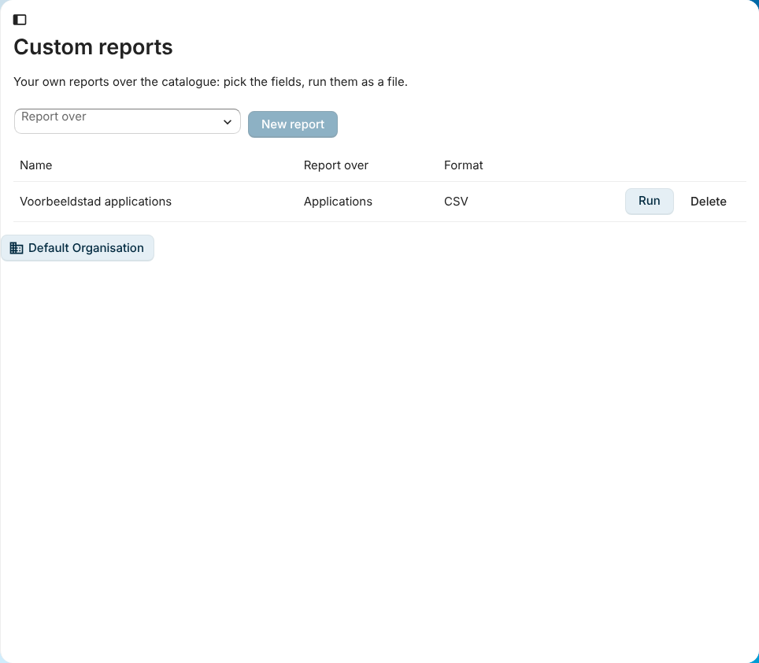

<!--
  - SPDX-FileCopyrightText: 2026 Conduction B.V. <info@conduction.nl>
  - SPDX-License-Identifier: EUPL-1.2
  -->

# Catalogue exports and custom reports

Take the catalogue out of the app as a file: the rows a list shows, the
applications and services a GEMMA facet selection leaves, one organisation as
ArchiMate, and reports you define yourself.

Specification: [`openspec/changes/archive/2026-11-25-insight-exports-and-custom-reports/specs/catalogue-exports-and-reports/spec.md`](https://github.com/ConductionNL/stackiq/blob/development/openspec/changes/archive/2026-11-25-insight-exports-and-custom-reports/specs/catalogue-exports-and-reports/spec.md).

## Export a list (REQ-CER-001)

The Compliances (`/komplianties`) and Application versions (`/moduleversies`)
pages offer **Export as CSV** and **Export as Excel** in their toolbar.
OpenRegister writes the file from the rows the page filters to and checks
your right to export the schema. Contracts and Organisations get the same
menu once the component library forwards their page filter and quick filter,
so that a file never holds rows the page hides.

The menu shows once OpenRegister keeps the schema's `exportable` flag; the
four schemas declare it in `lib/Settings/register.d/insight-exports-and-custom-reports.json`.

## Export a faceted list (REQ-CER-002)

On Applications (`/modules`) and Services (`/diensten`) the **Export** menu
writes what the list shows: the GEMMA facet selection, the active quick
filter (for example BBN2) and the search, with the page's columns.

- Endpoint: `GET /apps/stackiq/api/catalog/{schema}/export`, for `module` and
  `catalogService` only.
- Rows are read with your own access rights. A schema that names an `export`
  grant refuses callers outside it with 403.
- The export holds at most as many rows as the list can match. When that
  ceiling is reached, the file's last row says the set was cut, so a cut file
  never looks complete.

## Export an organisation as ArchiMate (REQ-CER-003)

The organisation detail page (`/organisaties/{id}`) shows **Export as
ArchiMate** when you may export that organisation: it is your active
organisation, or you are a Nextcloud admin or in `ambtenaar`. Others do not
see the action, and the export answers them 403 before any work starts.

- Download: `GET /apps/stackiq/api/archimate/export/organization/{uuid}`.
- The page asks `GET /apps/stackiq/api/archimate/export/organization/{uuid}/access`
  (`{mayExport: true|false}`) first. Both answer from the same rule, the one
  the portfolio report uses.

## Custom reports (REQ-CER-004)

**Reports → Custom reports** (`/reports/custom`) lists the reports you made.
A report is an OpenRegister export profile over one catalogue list:

1. Pick the list (Applications, Services, Organisations, Contracts,
   Application versions or Compliances) and choose **New report**.
2. Give it a name, choose its fields in the order of the columns, whether
   values are written as stored or as the lists show them, and CSV or JSON.
3. Optionally add rows of a field and the value it must equal, for example
   `bbnLevel` equals `BBN2`.
4. **Run** downloads the file from OpenRegister; **Delete** removes the report.

The page lists only your own reports, also for an administrator, to whom
OpenRegister returns everyone's. OpenRegister checks your right to export the
schema each time a report runs.

## Screenshots

The Export menu on Applications:

Export as ArchiMate on an organisation page:

Custom reports, with one report over Applications:

