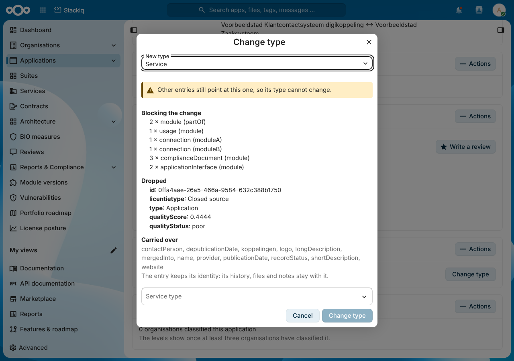

<!--
  - SPDX-FileCopyrightText: 2026 Conduction B.V. <info@conduction.nl>
  - SPDX-License-Identifier: EUPL-1.2
  -->

# Change entry type

An entry registered as the wrong kind can change type without being registered again: an application becomes a service or system software, and a service or system software becomes an application. The entry keeps its identity, so its history, files, notes and the links to it stay.

Specification: [`openspec/changes/archive/2026-11-25-landscape-change-entry-type/specs/entry-type-change/spec.md`](https://github.com/ConductionNL/stackiq/blob/development/openspec/changes/archive/2026-11-25-landscape-change-entry-type/specs/entry-type-change/spec.md).

## Changing the type

1. Open the application's page from **Applications**.
2. In **Entry type**, click **Change type**.
3. Pick the **New type**. The dialog shows the preview (below).
4. For a service, pick at least one **Service type**.
5. Click **Change type**.

A change to a service moves the entry to the services, and stackiq opens the **Services** list. A change between Application and System software only sets the application's **Type**, and the page reloads. The application form also shows **Type**, so this switch can be made there too.

## The preview

Before anything changes, the dialog lists:

- **Carried over**: the fields both types have, which keep their values.
- **Dropped**: the filled fields the new type does not have, each with its value. These values are cleared by the change.
- **Blocking the change**: other entries that still point at this one and that the new type cannot hold, with how many there are. An application with usages, versions or connections cannot become a service; a service with contracts cannot become an application.

While anything blocks the change, **Change type** stays disabled. Remove or move the blocking entries first.

## Who may change a type

You need the right to edit the entry and to create an entry of the new type. Without it, stackiq refuses the change and nothing is changed.
