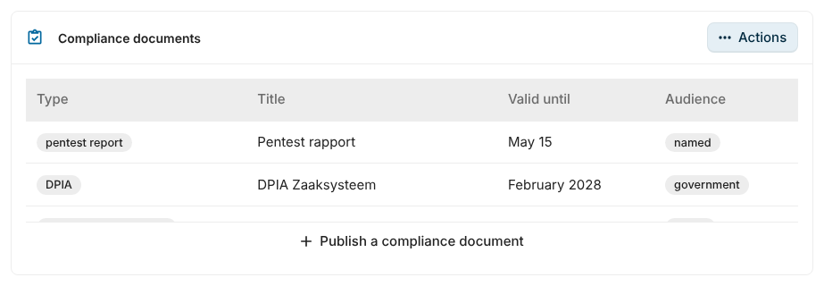

<!--
  - SPDX-FileCopyrightText: 2026 Conduction B.V. <info@conduction.nl>
  - SPDX-License-Identifier: EUPL-1.2
  -->

# Compliance documents

Organisations publish compliance documents about an application, so other organisations can reuse them instead of asking the supplier again. A document is a DPIA, a processing agreement, a pentest report, an assurance report, a certificate, an ENSIA statement or another kind.

## Publishing a document

Open the application and go to **Compliance documents**. Choose **Publish a compliance document** and fill in:

- the type of document,
- a title and a short summary,
- the date it was issued and the date it is valid until,
- who may read it (the audience), and for a named share the organisations it is shared with.

Attach the file to the document on its own page, under **Document**.

## Who reads a document

The audience decides who reads a document.

| Audience | Who reads it |
|---|---|
| Public | Anyone, also visitors who are not signed in. |
| Government | Users of the government organisations in the catalogue. |
| Named | Only the organisations listed under shared with. |

A new document starts with the audience named, so nothing is shared until you choose to. The organisation that published a document always reads and edits it.

OpenRegister applies these rules on every read. The application page and the documents list only show the documents you may read.

## Finding documents

**Applications > Compliance documents** lists every document you may read. Filter on the type of document with the buttons above the list.

On an application page the documents are sorted on the date they are valid until, so the documents that expire first come first.
