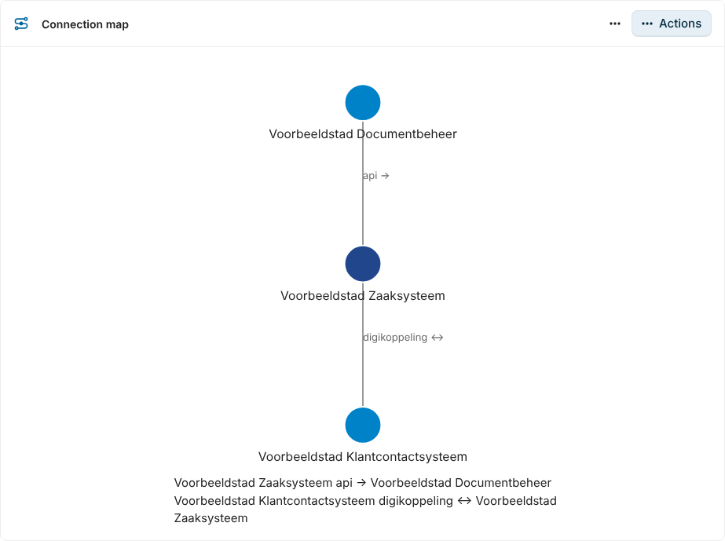

<!--
  - SPDX-FileCopyrightText: 2026 Conduction B.V. <info@conduction.nl>
  - SPDX-License-Identifier: EUPL-1.2
  -->

# Connections

A connection records that one application exchanges data with another application, or with a national provision such as a basisregistratie: over which transport, in which direction, and in which state.

Specification: [`openspec/specs/catalogue-connection-pages/spec.md`](https://github.com/ConductionNL/stackiq/blob/development/openspec/specs/catalogue-connection-pages/spec.md).

## The connections list

Open **Applications** in the navigation menu, then **Connections**. The list at `/koppelingen` shows every connection you may read, with its type, its status, both applications, the national provision and the direction.

- The chips above the list filter on status: in use, in development, end of support and withdrawn.
- The filter menu in the table header filters on type (for example api or file transfer), status and direction.
- Click a row to open the connection.

You see the connections of your own organisation, and the connections that are published.

## A connection's page

The page shows the connection's data, both applications, the national provision and the intermediary application if there is one, the lifecycle dates, attached documents, and its history.

The actions at the top move a connection through its lifecycle: release (in development to in use), sunset (in use to end of support) and withdraw (to withdrawn).

When you record a connection to a national provision, the picker lists the GEMMA elements of type Buitengemeentelijke voorziening.

## Connections on the application page

The page of an application has two lists: **Connections from this application**, where it is application A, and **Connections to this application**, where it is application B. Each row opens the connection, and View all opens the connections list filtered on that application.

## The connection map

The page of an application also shows its connections as a map. The application sits in the centre. Every application or national provision it has a connection with sits around it. Each line is one connection, labelled with its transport type, with an arrow in the direction the data goes. A line to a national provision is dashed.

Click an application on the map to open its page. Click a line to open the connection. The map shows only connections you may read.

The menu of the map downloads:

- the drawing as SVG or as PNG;
- the links as CSV, one line per connection, with application A, the direction, application B or the national provision, the transport type and the status.

The download is made in your browser, from the connections on the map.

## Connections in the ArchiMate export

The organisation ArchiMate export, under Settings, has a **Connections** option. With it ticked, the export writes every connection between the applications in the file as an ArchiMate flow relationship. A connection to a national provision becomes a flow to that provision's element. Each flow carries the transport type, the direction and the status as properties. A bi-directional connection becomes two flows.

A connection whose other end is not in the exported model is left out. The number left out is in the `X-Stackiq-Connections-Skipped` header of the download.
