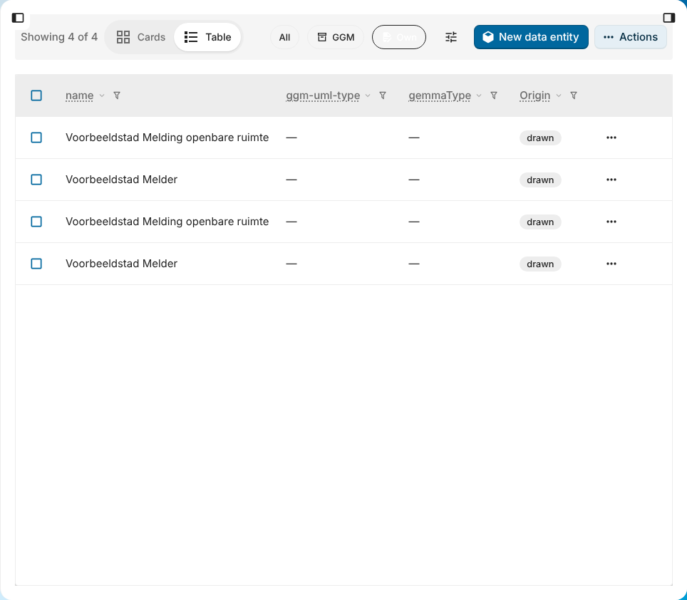
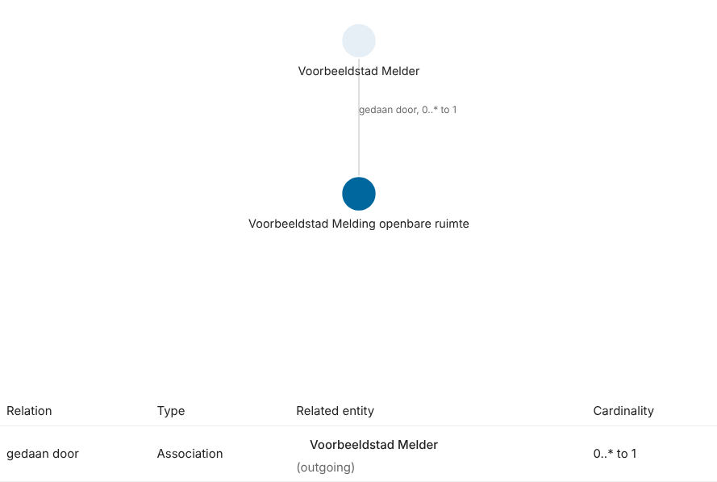
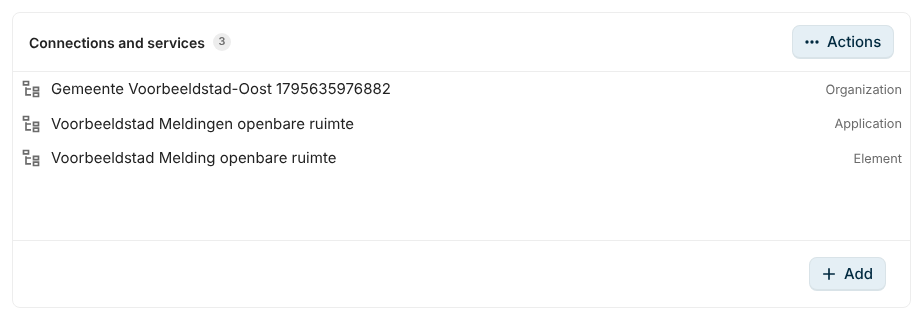

<!--
  - SPDX-FileCopyrightText: 2026 Conduction B.V. <info@conduction.nl>
  - SPDX-License-Identifier: EUPL-1.2
  -->

# Data model

The Data model shows the data entities of the Gemeentelijk Gegevensmodel (GGM) and the entities your organisation adds itself, each with its relations to other entities. For every application in use you record which entities it holds data for, and the page of an entity lists those applications.

Specification: [`openspec/changes/archive/2026-11-25-architecture-data-model-and-ggm/specs/data-model-and-ggm/spec.md`](https://github.com/ConductionNL/stackiq/blob/development/openspec/changes/archive/2026-11-25-architecture-data-model-and-ggm/specs/data-model-and-ggm/spec.md).

## Finding a data entity

Open **Architecture** in the navigation menu, then **Data model**. The list holds every ArchiMate business object in the architecture model, with its name, GGM UML type, GEMMA type and origin. The quick filters narrow it down:

- **All**: every data entity.
- **GGM**: the entities a GEMMA import brought in, such as Werknemer and Aanvraag.
- **Own**: the entities your organisation added.

Search on a name to find one entity, and click it to open its page.

## The page of a data entity

The page shows the entity's name, documentation, GGM guid, GGM UML type and origin, and three sections:

- **Relations** draws the entity in the middle with every entity it is related to around it, by an association, aggregation, composition or specialization. Each line carries the relation's name, or its type when it has no name, and the cardinalities when they are set, such as *gedaan door, 0..\* to 1*. A specialization is drawn dashed. The table under the drawing lists the same relations as text; click an entity in the drawing or in the table to open its page. Only the direct neighbours are drawn, and when an entity has more than 200 relations at one end the page says so.
- **Attributes** lists the attributes of an entity your organisation added, the key attributes first and marked *key*. A GGM entity shows that the GGM does not publish attributes in the GEMMA file.
- **Applications that hold this data** lists the applications in use whose data entities name this entity.

## Adding your own data entity

On the Data model page, click **New data entity** and fill in the **Name**, the **Documentation** and, if you like, the **Attributes**. The entity is stored as an ArchiMate business object of your own, so the view editor can place it next to GGM entities, and a GEMMA re-import never changes it.

On the entity's page, click **Edit attributes** to add, change or remove attributes. Each attribute has a **Name**, a **Data type** (text, number, date, yes or no, or reference), **Part of the key** when it identifies the entity, and a **Description**. Click **Save attributes** to store them.

A relation drawn between two of your own entities in the view editor can carry a **Source cardinality** and a **Target cardinality**: `0..1`, `1`, `0..*` or `1..*`.

## Linking an application in use to data entities

Open **Applications**, then **Applications in use**, and open the application. Edit it and pick the entities it holds data for under **Data entities**; the picker offers data entities only. After saving, the page lists them, and the page of each entity lists the application under **Applications that hold this data**.

## Importing a newer GGM

The GGM arrives with the GEMMA release: its 503 entities and the relations between them are part of the GEMMA architecture model. To use a newer GGM, download its AMEFF file and ask a Nextcloud admin to import it in the stackiq admin settings, under **ArchiMate Import/Export**, as they would import a GEMMA release. The import updates the GGM entities and leaves the entities your organisation added alone. The AMEFF file carries entities and relations but no attributes, so GGM entities show none.
