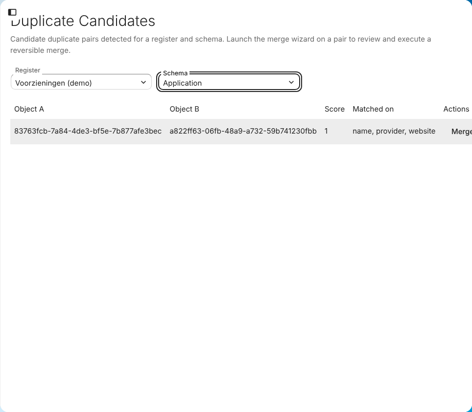
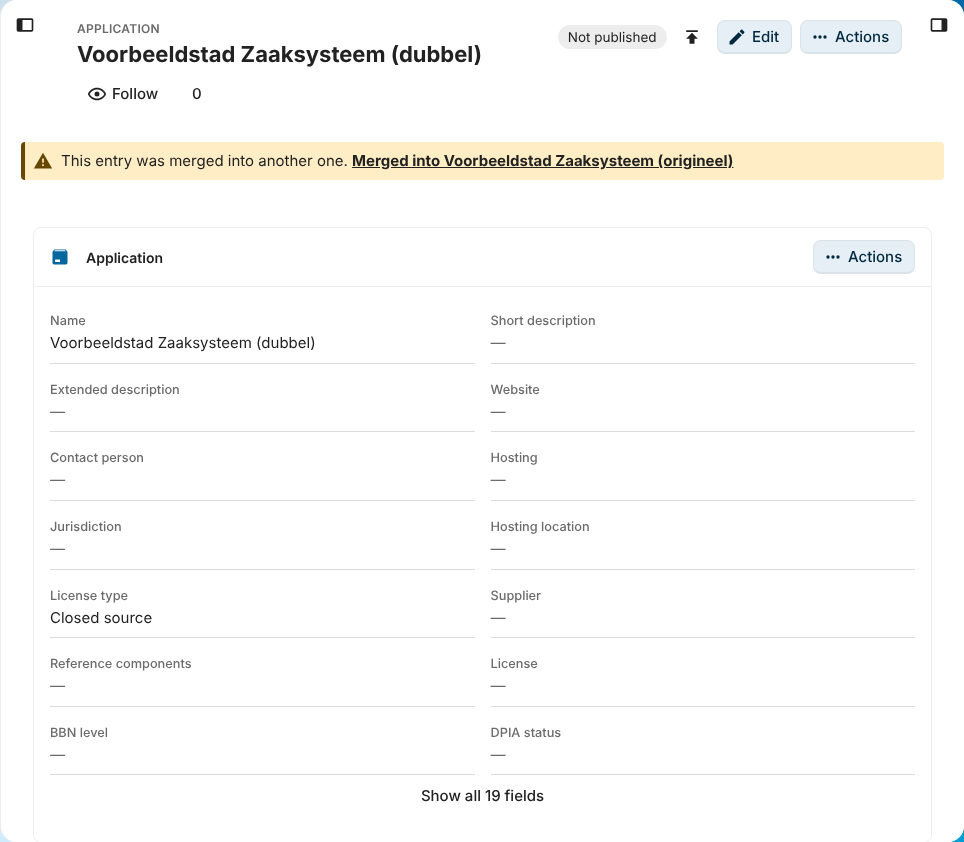

<!--
  - SPDX-FileCopyrightText: 2026 Conduction B.V. <info@conduction.nl>
  - SPDX-License-Identifier: EUPL-1.2
  -->

# Record reconciliation

The catalogue can hold the same application or service twice, for example
after an import or when two people register it. Duplicates are found and
merged in OpenRegister; stackiq makes sure the rest of the catalogue follows
the merge.

Specification: [`openspec/changes/archive/2026-11-25-operations-record-reconciliation`](https://github.com/ConductionNL/stackiq/blob/development/openspec/specs/record-reconciliation/spec.md).

## Who can do this

Nextcloud admins and functional administrators (members of the
`functioneel-beheerder` group). Other users do not see **Find duplicates**.

## Finding and merging duplicates

1. Open **Applications**, **Services** or **Organisation relationships**.
2. Choose **Find duplicates** in the toolbar (on the organisations page, in
   the page header). OpenRegister's **Duplicate
   candidates** page opens.

   
3. Pick the register and schema. The page lists the pairs that look alike.
   Applications and services are compared on their name (normalised and by
   spelling distance), their supplier and their website; a pair that scores
   0.7 or more is a candidate. The page names each record of a pair by its
   id; **Matched on** says which fields matched.

   
4. Open a pair to start OpenRegister's merge wizard, check the preview, and
   merge. Or dismiss a pair that is not a duplicate.

Organisations found this way are merged with stackiq's own
[organisation merge](organisation-merge.md).

## What happens after a merge

When OpenRegister merges two applications or two services, stackiq:

- points every reference to the merged record at the record it was merged
  into: usages, connections, suites, services, vulnerabilities, reviews,
  compliance records and versions for an application; usages, contracts,
  connections, reviews and applications for a service. An array that would
  list the survivor twice lists it once;
- sets the merged record's **Record status** to Merged and its
  **Merged into** to the survivor;
- writes one audit entry per moved reference, with the merge operation id.

A merged record leaves the **Applications** and **Services** lists and their
filter counts. Its page stays reachable, so an old link still works, and
shows a banner with a link to the record it was merged into.

## Reversing a merge

OpenRegister can reverse a merge for 30 days. A reversal brings the merged
record back, but **does not yet move the references back**: they stay on the
survivor. The audit entries list every moved reference with the merge
operation id, so a steward can put them back by hand.

A record that came in through federation is a mirror of another catalogue.
Merging a mirror away does not stick: the next synchronisation brings it
back. Keep the mirror as the survivor, or dismiss the pair.

## Demo data

The demo data holds one likely duplicate, **Voorbeeld name 1** next to
**Voorbeeld Name 1**, with the same supplier and website, so the candidates
page has a pair on a fresh instance.
