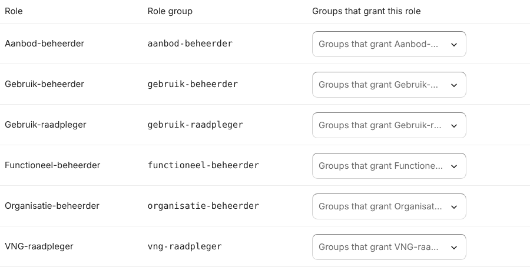
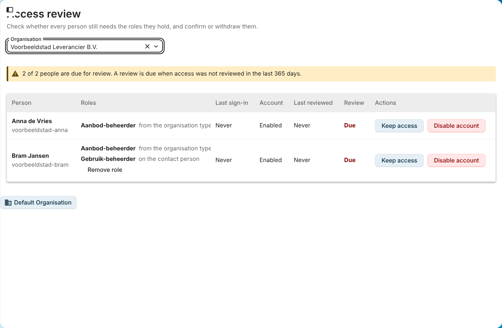

<!--
  - SPDX-FileCopyrightText: 2026 Conduction B.V. <info@conduction.nl>
  - SPDX-License-Identifier: EUPL-1.2
  -->

# Role mapping and access review

Two features that belong together:

- **Role mapping.** A Nextcloud admin chooses, per catalogue role, which of the
  organisation's own groups grant it. A municipality that keeps its buyers in a
  group called *Inkoop* maps Gebruik-beheerder onto Inkoop, and stackiq keeps
  those people in the role group the access rules use. Nobody copies members
  by hand.
- **Access review.** A functional administrator sees, per organisation, who
  holds which role, where each role comes from, when they last signed in and
  when their access was last reviewed, and confirms or withdraws it.

Specification:
[`openspec/changes/organisations-role-mapping-and-access-review/specs/role-mapping-and-access-review/spec.md`](https://github.com/ConductionNL/stackiq/blob/development/openspec/changes/organisations-role-mapping-and-access-review/specs/role-mapping-and-access-review/spec.md).

## Role groups

Each catalogue role has a fixed, lower-case **role group**. The register's
access rules name these groups, so the groups keep their names:

| Role | Role group |
|------|------------|
| Aanbod-beheerder | `aanbod-beheerder` |
| Gebruik-beheerder | `gebruik-beheerder` |
| Gebruik-raadpleger | `gebruik-raadpleger` |
| Functioneel-beheerder | `functioneel-beheerder` |
| Organisatie-beheerder | `organisatie-beheerder` |
| VNG-raadpleger | `vng-raadpleger` |

A person's roles come from three sources, and stackiq puts them in exactly the
role groups of those roles:

1. the **roles on their contact person**;
2. the **mapped groups** they are in (Inkoop grants Gebruik-beheerder);
3. the **default role of their organisation's type** (Municipality and
   Collaboration: Gebruik-beheerder; Supplier and Community: Aanbod-beheerder,
   editable in the mapping).

Role and group names are compared without regard to case. Only the role groups
above are ever changed; every other group a person is in stays as it is. An
account without a contact person is not a catalogue user and is left alone.

### When the role groups are brought in step

- when a contact person's roles are saved;
- at every sign-in;
- after an admin saves the mapping, for the members of every group whose
  mapped roles changed;
- nightly, for every contact person with an account, in batches of 100, so a
  change in a directory group reaches people who do not sign in.

### The upgrade takes nobody's access

Before this feature an admin could put someone in `gebruik-beheerder` by hand
without the role on their contact person. The sync would take them out. So the
upgrade first writes the role of every role group onto the contact person of
each current member, and logs each write. Until that has finished without a
failed write, the sign-in and nightly sync do not run; the nightly job retries
the step.

## The mapping in admin settings

In stackiq's admin settings, section **User Groups Configuration**, tab
**Role mapping**:

- per role, its role group and the groups that grant it (choose existing
  groups or type a group id);
- the default role per organisation type, or none;
- the **review interval** in days (default 365, at most 3650).

Only a Nextcloud admin reads or changes the mapping. It is saved with the rest
of the user groups configuration (`/api/user-groups/config`); an invalid
mapping is refused as a whole.

## The Access review page

**Organisations > Access review** (`/organisaties/access-review`). A Nextcloud
admin picks any organisation; a member of `functioneel-beheerder` or
`organisatie-beheerder` reviews their own active organisation. Anyone else is
refused.

Each person with an account is a row with:

- their roles, each with where it comes from (on the contact person, from the
  group X, from the organisation type Y);
- their last sign-in, and whether the account is enabled;
- when their access was last reviewed, and by whom;
- whether a review is **due**: never reviewed, or longer ago than the interval.

Actions:

- **Keep access** records the review on the contact person
  (`accessReviewedAt`, `accessReviewedBy`), so its history shows who confirmed
  whom and when. A reviewer cannot confirm their own access.
- **Remove role** takes a role off the contact person, and the person leaves
  its role group. A role that comes from a mapped group or the organisation
  type cannot be removed here: the page names the group, and that group is
  where to change it.
- **Disable account**, for a Nextcloud admin only.

Endpoints: `GET /api/access-review/{organisationUuid}`,
`POST /api/access-review/{contactPersonId}/confirm` and
`POST /api/access-review/{contactPersonId}/withdraw` (body `role`).

## Demo data

The demo dataset gives the first demo contact person a review a week before
the import and the second one fourteen months before it; the third has never
been reviewed. The dates are written relative (`-P7D`, `-P14M`) and resolved
against the import date, so they do not age.

## SAML and OpenID Connect

Mapping identity provider claims to roles is not done here. OpenRegister
derives groups from sign-in claims (its derived grants); an admin who signs in
through SAML or OpenID Connect maps claims onto the role groups above there,
and the role mapping then works on those groups like on any other.

## Not covered

- Reminders when a review falls due; the page shows what is due.
- Reviewing Nextcloud admins or accounts outside the catalogue.
